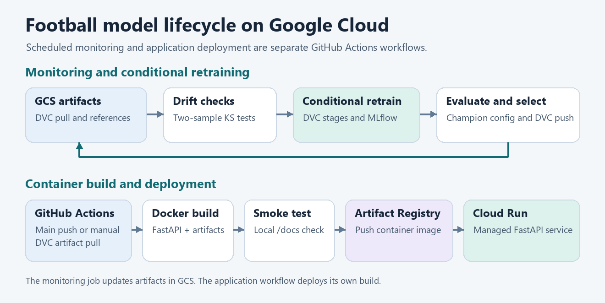

# Football MLOps

As part of a team project, we built and deployed a football prediction platform on Google Cloud Run. It uses DVC and Cloud Storage for versioned data and model artifacts, MLflow for experiment tracking, and a Dockerized FastAPI service for inference. I worked on the API, Cloud Run deployment, and drift-triggered retraining.

## Model lifecycle and deployment

1. **Train and track.** Data ingestion combines Football-Data.co.uk and FBref feeds. The pipeline versions processed data, XGBoost model artifacts, evaluation reports and champion configuration with DVC. MLflow records training metrics and drift reports.
2. **Monitor and retrain.** A scheduled GitHub Actions workflow pulls DVC artifacts. Two-sample Kolmogorov–Smirnov tests compare numeric features with reference data. When more than 30% of eligible features drift in any monitored dataset, the workflow calls the relevant DVC stages. Champion selection ranks macro-F1 first and uses accuracy to break ties. The workflow pushes updated artifacts to Cloud Storage.
3. **Build and serve.** On a main-branch push or manual dispatch, a separate GitHub Actions workflow pulls artifacts, builds the Docker image, checks the local container’s `/docs` endpoint, pushes the image to Artifact Registry and deploys it to managed Cloud Run in `europe-west4`.

The service exposes goal regression, home/draw/away classification, lineup-based inference and champion metadata. The team also built a Streamlit dashboard for predictions, metrics and drift. Training, monitoring and release are visible as concrete steps in the repository.

## Technical evidence

- [Feature-level drift detection](code/drift_monitor.py)
- [Conditional retraining and artifact push](code/conditional_retraining.py)
- [Champion selection and artifact output](code/champion_selection.py)
- [Container smoke test, image push and Cloud Run deploy](code/deploy-excerpt.yml)

**Tools** · Python, XGBoost, SciPy, DVC, MLflow, FastAPI, Uvicorn, Docker, GitHub Actions, Cloud Storage, Artifact Registry, Cloud Run and Streamlit.

**Source** · [Canonical team repository](https://github.com/TSM-MachLedata/MLOps) · [Code and deployment provenance](../../docs/evidence-register.md#football-mlops)

