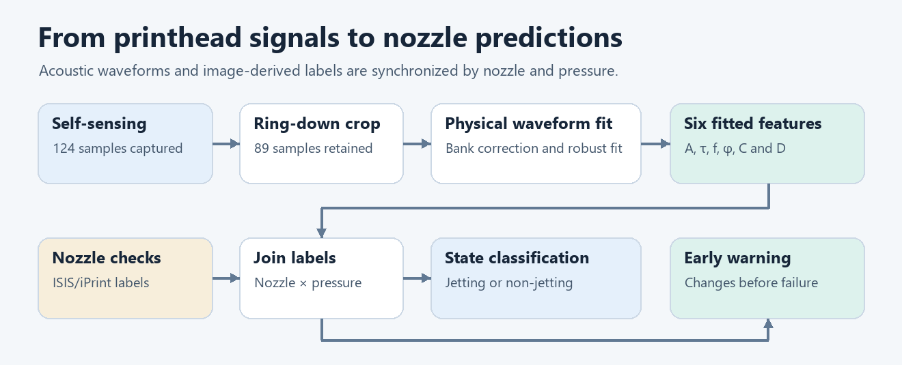
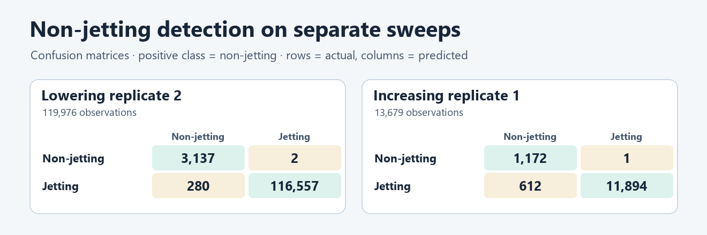
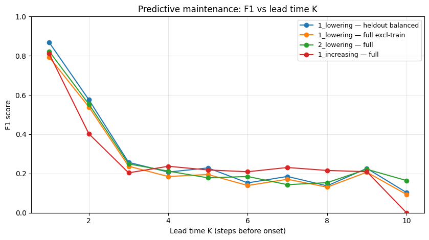

# iPrint Predictive Maintenance

I built a signal-processing and machine-learning pipeline to detect non-jetting in a piezoelectric inkjet printhead and test how early its acoustic signature appears. The HEIA-FR project was carried out with iPrint using synchronized self-sensing waveforms and image-derived nozzle labels.

## From waveform to features

One printhead comprised 1,280 nozzles across four electrical banks. Each lowering-pressure replicate covered 95 steps, yielding 121,600 nominal nozzle–pressure pairs. I cropped the initial actuation response from each waveform and kept the 89-sample ring-down. After correcting bank polarity, I used robust windowed least squares to fit a damped sinusoid with a linear baseline. The six features were amplitude, damping time, frequency, phase, offset and slope.

I implemented preprocessing, physical fitting and model evaluation. iPrint supplied acquisition data, and the ISIS/iPrint team generated nozzle-state labels from printed checks. I trained a histogram gradient boosting classifier on the six features and used a nozzle-grouped holdout. The warning model used step-to-step changes in the fitted features to predict non-jetting onset at different lead times.

## Results across operating sequences

| Nozzle-state evaluation | Observations | Accuracy | Non-jetting F1 |
| --- | ---: | ---: | ---: |
| Balanced held-out nozzles, lowering replicate 1 | 1,002 | 99.9% | 0.999 |
| Separate lowering replicate | 119,976 | 99.8% | 0.957 |
| Increasing-pressure replicate | 13,679 | 95.5% | 0.793 |

On the balanced held-out nozzles, early-warning F1 was **0.868 one step before onset**, **0.576 two steps before**, and **0.257 three steps before**. Lead time is measured in pressure steps on one experimental printhead. The pressure regression reached **6.09 mbar MAE** and **0.506 R²** on held-out nozzles, showing that the acoustic features also captured operating pressure.

## Technical evidence

- [Damped-sinusoid fitting and window summary](code/ringdown_fit.py)
- [Onset-relative acoustic features](code/lead_time_features.py)

**Tools** · Python, NumPy, SciPy, pandas, scikit-learn, Matplotlib and Colab.

**Source** · [PA project repository](https://github.com/PA-iPrint-anomaly-detection/PA) · [Code, figure and report provenance](../../docs/evidence-register.md#iprint-predictive-maintenance)

