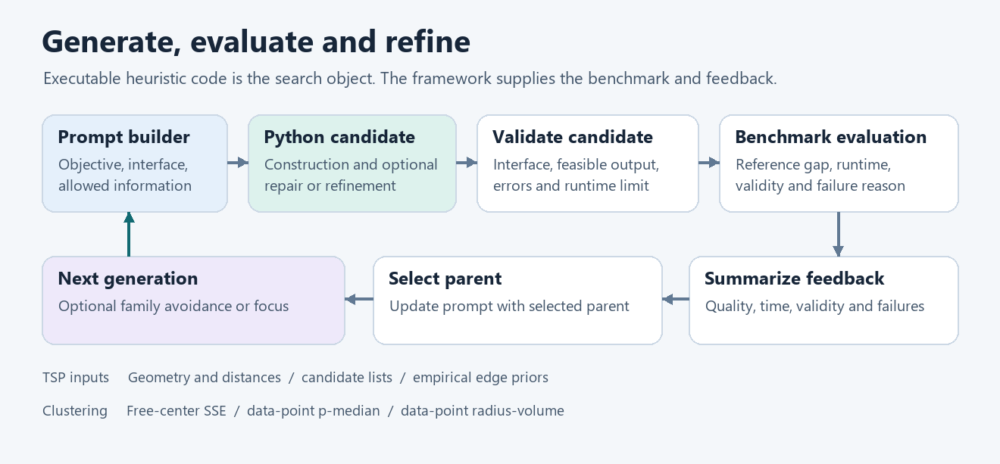
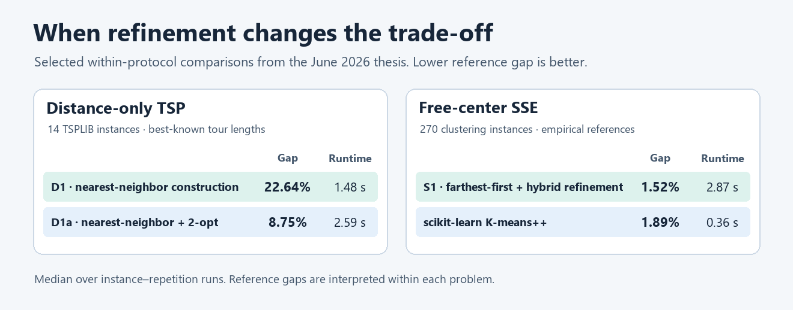

# LLM Optimization Thesis

For my June 2026 HES-SO MSE thesis, supervised by Prof. Eric Taillard, I built an LLM-guided framework for designing and evaluating executable Python heuristics for the traveling salesman problem (TSP) and centroid clustering. I used it to study which mechanisms emerge under different problem interfaces, how they use feedback, and where construction, repair and external information contribute to quality.

## Experimental system

I developed the generation loop, problem interfaces, feasibility checks, time limits, failure reporting and final evaluators. Groq-hosted Llama 3.3 70B proposed candidate code. The framework scored feasible tours or center sets, summarized failures and performance, and used elitist or sequential parent selection to build the next prompt. Family avoidance and family-focused prompting helped test a wider range of mechanisms. Code inspection checked whether generated candidates actually implemented their stated mechanisms.

| TSP information regimes | Clustering objectives |
| --- | --- |
| **Distance-only** uses geometry and distances from the instance. | **SSE** minimizes squared distances to free centers. |
| **Candidate lists** supply LKH/POPMUSIC neighbor lists. | **Data-point p-median** minimizes Euclidean distances to input-point centers. |
| **Edge priors** supply edge frequencies from earlier short searches. | **Radius-volume** sums the dimension-powered radii around input-point centers. |

## Final benchmark findings

The final evaluation used **14 TSPLIB instances** with up to **85,900 cities** and **270 synthetic clustering instances** with up to **10,000 points**. I compared median reference gap and runtime, seed-to-seed and instance-to-instance variability, and empirical scaling. The main evaluations used 100 repetitions per instance, with reduced coverage for some external baselines.

- **Distance-only TSP.** Adding 2-opt to the nearest-neighbor construction reduced the median reference gap from **22.64% to 8.75%**, with median runtime rising from 1.48 s to 2.59 s.
- **Signal-assisted TSP.** On the 12-instance assisted benchmark, C1a reached a **13.46%** median gap with candidate lists and adaptive cleanup. P1 reached **4.67%** using precomputed edge priors and bounded repair. Its repetition standard deviation was 0.01 percentage points and its instance standard deviation was 8.39 points. These results measure different information regimes from distance-only TSP.
- **Clustering.** Under SSE, generated S1 reached **1.52%** median reference gap versus **1.89%** for scikit-learn K-means++, with longer runtime. Sampled p-median P1 reached **1.90%** versus **−0.77%** for FastPAM1. For radius-volume, R1 reached **−2.35%, 37.04% and 92.53%** in dimensions 2, 3 and 4. Adapted external methods remained competitive. Negative gaps indicate improvements over empirical references.

The loop produced executable variations on established mechanisms. Construction and bounded refinement came from candidate code. Problem signals, validation, references and parent selection came from the framework and shaped the final outcomes.

## Technical evidence

- [TSP tour validation and benchmark scoring](code/tsp_evaluation.py)
- [Elitist and sequential parent selection](code/parent_selection.py)
- [Batched clustering objective functions](code/clustering_objectives.py)
- [C1a: LLM-generated, curated candidate selected for evaluation](code/tsp_candidate_c1a.py)

**Tools** · Python, NumPy, pandas, Colab, Groq, TSPLIB, LKH/POPMUSIC, scikit-learn and k-medoids baselines.

**Sources** · [TSP repository](https://github.com/TM-HESSO-202526/llm-tsp-heuristics) · [Clustering repository](https://github.com/TM-HESSO-202526/llm-clustering-heuristics) · [June 2026 report and benchmark table locators](../../docs/evidence-register.md#llm-optimization-thesis)

