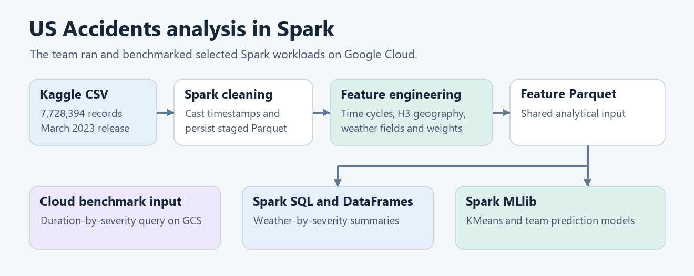
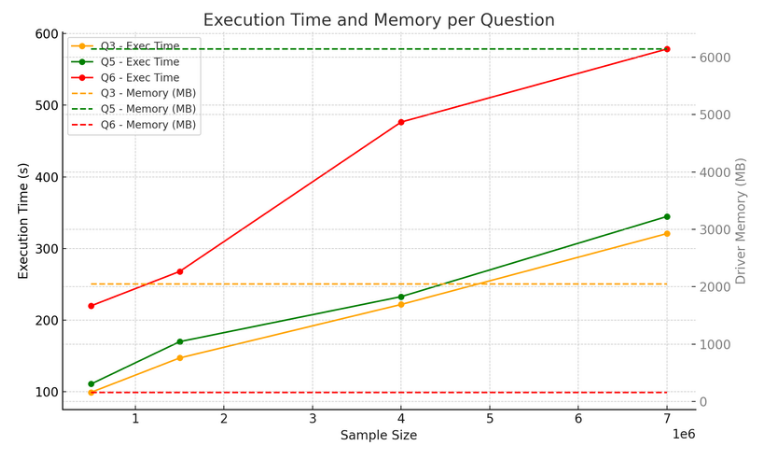
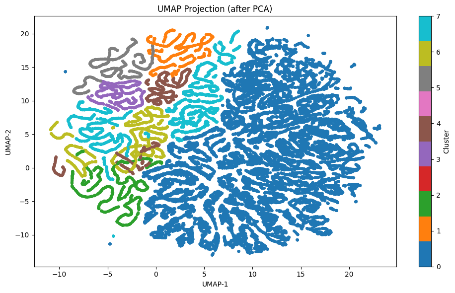

# US Accidents / Spark

As part of an MA-BDA team project, we analyzed **7,728,394 US traffic incident records** from 2016–2023, approximately **3.06 GB**, with Apache Spark. We ran and benchmarked Spark workloads on Google Cloud, including a Spark query that read its input from Cloud Storage. I worked on weather and severity analysis, Scala and PySpark processing, and clustering.

## Distributed analysis

The team staged the cleaned CSV in Parquet and prepared shared features for time, weather, geography and class imbalance. The feature builder encoded time cycles and mapped coordinates into H3 cells. Spark aggregations summarized weather by severity, while Spark MLlib assembled standardized weather and spatial features for an eight-cluster KMeans model evaluated with silhouette.

## Cloud benchmarking

We benchmarked duration regression, clustering and count prediction on Google Cloud with inputs of up to **7 million rows**. Memory settings differed by workload.

## Technical evidence

- [Grouped weather statistics and condition counts in Scala](code/weather_by_severity.scala)
- [Feature assembly, MLlib KMeans and silhouette in PySpark](code/spark_clustering.py)

Exploratory clustering visualization

PCA-to-UMAP view of an exploratory scikit-learn clustering run. Mapping each cluster to its dominant severity gave **68.54% correspondence** on a balanced subset of severity levels 2 and 3.

**Tools** · Apache Spark, Spark SQL/DataFrames, Spark MLlib, Scala, PySpark, Parquet, H3, Google Cloud and Cloud Storage.

**Source** · MA-BDA academic team repository · [Code, plots and cloud evidence](../../docs/evidence-register.md#us-accidents--spark)

