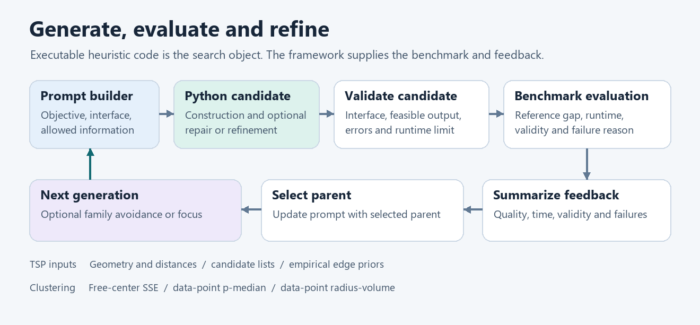
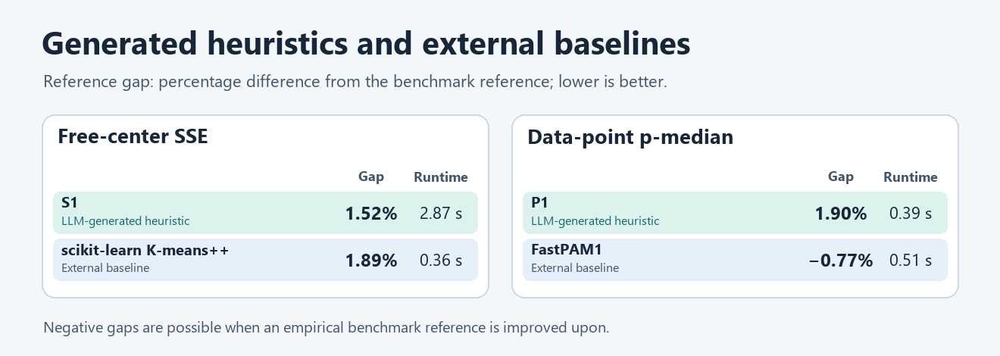

# LLM-Guided Automatic Heuristic Design

Designing optimization heuristics is traditionally an iterative specialist task.

A researcher proposes an algorithmic idea, implements it, evaluates it on benchmark instances, studies where it fails, modifies the mechanism, and repeats the process. This can produce strong heuristics, but exploring many alternative designs is time-consuming and depends heavily on expert intuition.

The master thesis investigated whether a **large language model could accelerate part of this design loop** by repeatedly generating executable heuristic candidates, receiving measured feedback, and proposing revised algorithms.

The research question was therefore not whether an LLM could produce a complete state-of-the-art solver from one prompt. The objective was to study whether an LLM could act as a useful **algorithm-generation component inside an automated generate → evaluate → feedback → selection loop**.

## Generate, evaluate and refine

The framework searches over executable heuristic programs.

Each generation cycle follows the same structure:

1. define the optimization objective, the interface each generated heuristic must satisfy, and the information available to it;
2. ask the LLM to generate a heuristic candidate as executable Python code;
3. validate the program and ensure that its output is feasible;
4. evaluate the candidate on benchmark instances;
5. measure objective quality, runtime, validity and failure information;
6. summarize the measured feedback;
7. select a candidate to use as the parent of the next generation;
8. update the prompt and generate another heuristic.

This makes the LLM a **proposal mechanism** rather than the complete optimization system.

The surrounding framework supplies the benchmark, validation rules, feedback, runtime constraints and selection logic.

## Two optimization settings

The same generation methodology was studied across two different optimization domains.

| Traveling Salesman Problem | Clustering |
| --- | --- |
| Distance-only heuristic generation | Sum-of-squares clustering |
| Candidate-list guidance | Data-point p-median |
| Empirical edge-prior guidance | Radius-volume coverage |

The purpose of varying the information regime and optimization objective was to observe whether the generated mechanisms changed in response to the information and problem structure presented to the model.

## What the generation process revealed

The generation logs were important results in their own right.

Across the analyzed TSP experiments, approximately **57,000 heuristic-generation attempts** were produced. About **80%** returned valid executable tours.

This showed that generating runnable code was not the hardest problem. The more difficult objective was generating methods that were simultaneously:

- valid;
- competitive;
- computationally reasonable;
- and structurally different from candidates already explored.

With neutral prompting, the model repeatedly returned familiar TSP mechanisms, especially nearest-neighbour construction followed by 2-opt or related local improvement.

Longer runs also revealed an exploration/exploitation trade-off: once a useful parent candidate was found, later generations often refined or slightly modified the same mechanism instead of continually discovering new algorithm families.

The clustering experiments produced approximately **71,000 generated attempts**, with about **76%** returning valid executable center sets.

Changing the clustering objective also changed the algorithmic behavior produced by the LLM:

- SSE encouraged free-center initialization and refinement strategies;
- p-median encouraged medoid selection, sampling and medoid replacement;
- radius-volume encouraged radius-aware repair and coverage mechanisms.

The experiments therefore suggest that LLM-generated algorithms are strongly shaped by the optimization objective, the available information and the feedback provided by the surrounding framework.

## Benchmark results

The final **generated heuristics** were evaluated on the selected problem instances alongside established external baseline algorithms.

For each instance, both the generated heuristics and the baseline algorithms were compared against the same reference objective value.

**Reference gap** measures the percentage difference between an algorithm’s objective value and that reference value. A gap of **0%** means the reference is matched; lower values are better. Negative values are possible when an algorithm improves on the empirical reference.

Representative findings include:

- In distance-only TSP, adding local 2-opt refinement to nearest-neighbour construction reduced the median reference gap from **22.64% to 8.75%**.
- Under the SSE clustering objective, generated method S1 reached a **1.52% median reference gap**, compared with **1.89%** for the external scikit-learn K-means++ baseline, although with a higher runtime.

These results should not be interpreted as an LLM independently discovering a superior optimization solver.

The main result is that an LLM can participate productively in a **controlled heuristic-design pipeline**, rapidly proposing and recombining algorithmic mechanisms that can then be tested experimentally.

## Mechanism verification

Generated algorithm names were not treated as evidence of what the code actually implemented.

Code-level inspection was used to determine whether a candidate genuinely implemented the mechanism suggested by its description.

This distinction matters because some candidates labelled with more elaborate ideas ultimately reduced to familiar local mechanisms in their executed implementation.

The experiment therefore evaluated both **what the LLM claimed to generate** and **what the resulting code actually did**.

## Technical evidence

- [TSP feasibility validation and evaluation scoring](code/tsp_evaluation.py)
- [Parent-selection logic](code/parent_selection.py)
- [Clustering objective implementations](code/clustering_objectives.py)
- [LLM-generated P3 p-median heuristic](code/pmedian_candidate_p3.py)

## Technologies

Python · NumPy · pandas · Groq · Llama 3.3 70B · TSPLIB · LKH / POPMUSIC · scikit-learn · k-medoids

## Sources

[TSP source repository](https://github.com/TM-HESSO-202526/llm-tsp-heuristics) · [Clustering source repository](https://github.com/TM-HESSO-202526/llm-clustering-heuristics) · [Technical provenance](../../docs/evidence-register.md#llm-optimization-thesis)
