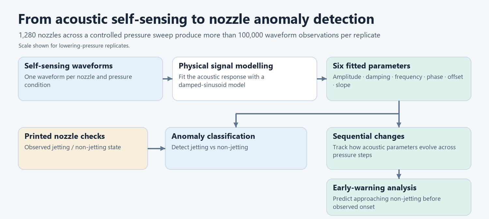
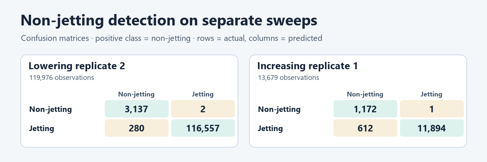
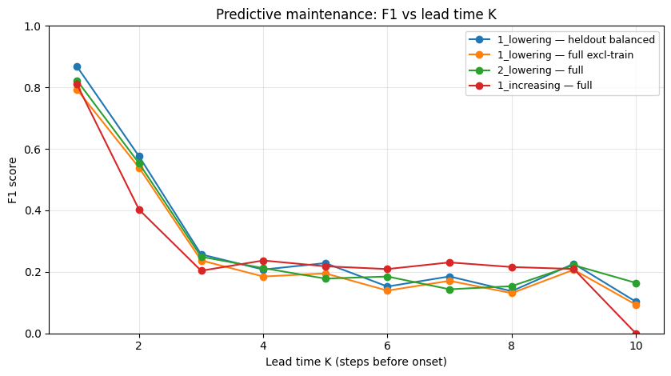

# iPrint Printhead Anomaly Detection & Early Warning

Industrial piezoelectric inkjet printheads contain dense arrays of microscopic nozzles. When a nozzle no longer ejects ink correctly, the defect can appear as a missing or degraded line in the printed output.

Conventional nozzle checks reveal these failures visually, but they are inherently reactive: the defect is detected after print quality has already deteriorated.

This project investigated whether the printhead's own **piezoelectric acoustic self-sensing response** could provide an internal signal of nozzle condition and whether changes in that response could reveal an approaching non-jetting event.

## Creating controlled failure conditions

A central challenge in predictive-maintenance research is obtaining enough examples of failure under controlled experimental conditions.

For this study, nozzle defects were reproduced through **controlled sweeps of meniscus pressure**.

Meniscus pressure is the pressure difference between the ink delivery system and the surrounding atmosphere at the nozzle opening. In normal operation it is maintained slightly negative so that ink remains inside the nozzle between firings.

Changing this pressure can move the nozzle outside its stable jetting regime. Excessive vacuum can starve the nozzle of ink and lead to weak ejection or complete misfires, while insufficient vacuum can contribute to flooding and unstable droplet formation.

Controlled pressure sweeps therefore provided a repeatable way to move the printhead through different operating conditions and **induce missing-line defects** for anomaly-detection and early-warning experiments.

This experiment should be understood as **pressure-induced defect simulation**, not as a literal reproduction of long-term mechanical wear, fouling or clogging.

### Main pressure sweep

The main dataset progressively decreased meniscus pressure from approximately:

**−50.0 mbar → −87.6 mbar**

in increments of:

**0.4 mbar**

for a total of **95 pressure levels**.

As the pressure became increasingly negative, the experiment progressively moved into operating regions where starvation and non-jetting became more likely.

### Robustness pressure sweep

A complementary dataset increased pressure from:

**−50.0 mbar → −44.0 mbar**

also in **0.4 mbar steps**.

This sequence covers a narrower and more stable operating range. Its purpose was not to reproduce the complete lowering sweep in reverse, but to test whether the learned acoustic signatures remained useful under a different pressure trajectory.

The terms **decreasing-pressure sweep** and **increasing-pressure sweep** in the results therefore describe these experimental operating trajectories.

## Dataset scale

The studied printhead contained **1,280 nozzles** distributed across four electrical banks.

At every pressure condition, acoustic self-sensing waveforms were recorded for the nozzles and synchronized with a printed nozzle-check image used to determine nozzle state.

A 95-step lowering-pressure replicate corresponds to approximately:

**121,600 nozzle × pressure waveform observations**

before label filtering.

This experimental scale is more representative of the dataset than the number of time samples contained inside an individual waveform.

## From acoustic response to physical features

After each piezoelectric actuation pulse, the coupled ink-cavity and piezoelectric system continues to oscillate briefly.

This post-actuation **ring-down** response contains information about the physical behavior of the nozzle cavity.

Rather than training directly on raw waveform values, the informative acoustic response was represented with a damped-sinusoid model.

Robust windowed fitting produced six physically interpretable parameters:

- **amplitude** — strength of the oscillation;
- **damping time** — how quickly the oscillation decays;
- **frequency** — dominant resonance of the fluid–structure system;
- **phase** — timing of the oscillation relative to the fitted response;
- **offset** — static signal baseline;
- **slope** — slow baseline drift.

These six values provide a compact acoustic representation of each nozzle under each pressure condition.

## Nozzle-state anomaly detection

Printed nozzle checks supplied the reference nozzle state.

The supervised analysis focused on two stable classes:

- **jetting** — an acceptable printed line is present;
- **non-jetting** — the printed line is absent.

A histogram gradient boosting classifier used the six fitted acoustic parameters to distinguish these two operating states.

Evaluation included a balanced held-out set, a separate lowering-pressure replicate, and the complementary increasing-pressure sequence.

| Evaluation | Observations | Accuracy | Non-jetting F1 |
| --- | ---: | ---: | ---: |
| Balanced held-out nozzles | 1,002 | 99.9% | 0.999 |
| Separate decreasing-pressure replicate | 119,976 | 99.8% | 0.957 |
| Increasing-pressure sequence | 13,679 | 95.5% | 0.793 |

The lowering-pressure results show that the fitted acoustic parameters contain a strong signature of non-jetting behavior.

The increasing-pressure dataset provides a complementary test under a different and more stable pressure trajectory rather than simply repeating the same acquisition conditions.

## Early-warning analysis

The project then moved beyond snapshot anomaly detection and asked whether the acoustic response changes **before the first observed non-jetting event**.

For each nozzle that eventually became non-jetting, acoustic features were evaluated at different numbers of pressure steps before its first failure.

On the balanced held-out evaluation:

- non-jetting F1 was **0.868 one pressure step before onset**;
- **0.576 two steps before onset**;
- **0.257 three steps before onset**.

The usable early-warning signal is therefore concentrated close to the transition: the acoustic parameters become strongly informative shortly before non-jetting, while predictive performance drops rapidly at longer horizons.

## Pressure as an important experimental variable

Pressure itself was not supplied to the nozzle-state classifier, but exploratory analysis showed that the fitted acoustic response also changes systematically with meniscus pressure.

A regression model trained to recover pressure from the acoustic parameters reached:

- **6.09 mbar MAE**
- **R² = 0.506**

on held-out nozzles.

This matters because the experimental defects were deliberately induced through pressure changes. Pressure can therefore influence both the acoustic features and the probability of observing a defect.

The pressure sweep is valuable for producing controlled failure transitions, but validation on naturally occurring fouling, clogging or wear under stable operating conditions would be required before drawing conclusions about long-term production maintenance.

## Technical evidence

- [Damped-sinusoid waveform fitting and robust parameter extraction](code/ringdown_fit.py)

## Technologies

Python · NumPy · SciPy · pandas · scikit-learn · Matplotlib · Google Colab

## Sources

[Project repository](https://github.com/PA-iPrint-anomaly-detection/PA) · [Technical evidence, figures and report provenance](../../docs/evidence-register.md#iprint-printhead-anomaly-detection--early-warning)
